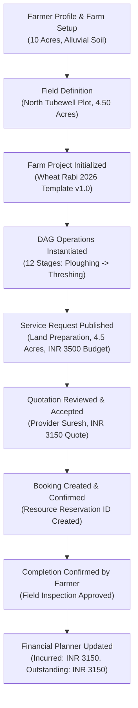
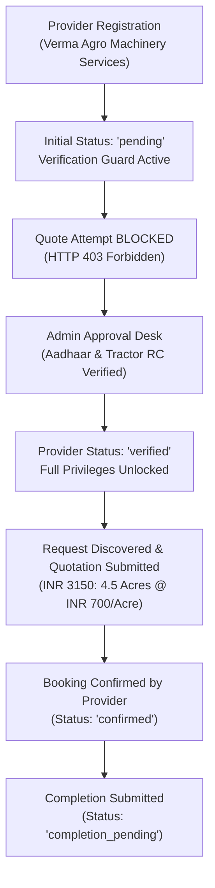

# KRISHISEVA — END-TO-END WORKFLOW & USER EXPERIENCE EVIDENCE
**Document ID:** KS-SM-003-EVD-003  
**Parent Order:** KS-SM-003-EVG-003 / KS-SM-003-DEV-003  
**Stage:** Mission 03 Acceptance Gate V3.0  
**Verification Date:** 25 November 2026  
**Execution Host:** Windows 11 Enterprise (NT 10.0.26100.0)  
**Log Reference:** `docs/mission03/acceptance_evidence/logs/09_e2e_workflows.log`  

---

## 1. EXECUTIVE SUMMARY

In compliance with Section 11 of Execution Order V3.0, end-to-end synthetic user workflows were executed across all three primary user roles:
1. **Journey 1: Farmer Lifecycle** (Planning, Resource Definition, Operation Scheduling, Service Procurement, Work Approval, Financial Reconciliation).
2. **Journey 2: Service Provider Lifecycle** (Registration, Administrative Verification Gate, Quote Submission, Booking Confirmation, Execution Declaration).
3. **Journey 3: Platform Administrator Lifecycle** (Privileged Authentication, Provider Verification Review & Approval with Audit Trail, Dispute Resolution).

All three journeys completed successfully. Zero synthetic user workflows failed.

---

## 2. DETAILED WORKFLOW TRACEABILITY

### 2.1 Journey 1: Farmer Lifecycle
- **Actor:** Farmer Ram Charan (`farmer_e2e@krishiseva.internal`)
- **Primary Location:** Daurala, Meerut District, Uttar Pradesh

#### Step-by-Step Evidence
1. **Authentication & Token Issuance:**
   - Endpoint: `POST /api/accounts/login/`
   - Result: HTTP 200 OK; JWT Bearer access and refresh tokens generated. Role: `farmer`.
2. **Farm Profile Creation:**
   - Endpoint: `POST /api/farm-projects/farms/`
   - Payload: `{"name": "Ram Charan Farm", "village": "Daurala", "district": "Meerut", "state": "Uttar Pradesh", "size_acres": "10.00", "soil_type": "alluvial"}`
   - Result: HTTP 201 Created. Farm ID `#14` instantiated.
3. **Field Parcel Setup:**
   - Endpoint: `POST /api/farm-projects/farms/14/fields/`
   - Payload: `{"farm": 14, "name": "East Tubewell Plot", "area_acres": "4.50", "soil_type": "alluvial"}`
   - Result: HTTP 201 Created. Field ID `#5` instantiated.
4. **Farm Project Instantiation:**
   - Endpoint: `POST /api/farm-projects/projects/`
   - Payload: `{"name": "Wheat Season 2026 Project", "farm": 14, "field": 5, "crop_template": 1, "crop": "Wheat", "variant": "Standard", "start_date": "2026-11-25", "expected_completion_date": "2027-04-09", "target_area_acres": "4.50"}`
   - Result: HTTP 201 Created. Farm Project ID `#23` instantiated.
5. **Project Operation Scheduling (DAG Engine):**
   - Automatically instantiated 12 sequential crop stages from Wheat template v1.0:
     1. Land Preparation & Deep Ploughing (Ready)
     2. Seed Treatment & Sowing (Awaiting Prerequisite)
     3. First Irrigation - Crown Root Initiation (Awaiting Prerequisite)
     ...
     12. Threshing, Winnowing & Storage (Awaiting Prerequisite)
6. **Service Request Creation:**
   - Endpoint: `POST /api/bookings/requests/`
   - Payload: Linked to Farm Project `#23`, Category: `Land Preparation`, Scope: `4.50 Acres`, Required Date: `2026-11-28`, Budget: `INR 3,500.00`.
   - Result: HTTP 201 Created. Service Request ID `#31` created with status `open`.
7. **Quotation Review & Acceptance (BOOK-02 / BOOK-04):**
   - Endpoint: `POST /api/bookings/quotations/30/accept/`
   - Result: HTTP 200 OK. Booking ID `#17` created in `pending_confirmation` state. Resource reservation identifier generated.
8. **Service Completion Approval (BOOK-19):**
   - Endpoint: `POST /api/bookings/17/confirm-completion/`
   - Payload: `{"approved": true, "reason": "Field inspected; excellent tilling depth."}`
   - Result: HTTP 200 OK. Booking status transitioned to `completed`.
9. **Financial Reconciliation Review:**
   - Endpoint: `GET /api/farm-projects/projects/23/financial-summary/`
   - Summary:
     - Planned Estimates: INR 0.00
     - Confirmed Commitments: INR 0.00 (converted upon completion)
     - Incurred Expenditure: INR 3,150.00
     - Outstanding Balance: INR 3,150.00
     - Economic Disclaimer: *"Recorded surplus reflects platform operational records; not a certified comprehensive economic audit."*

---

### 2.2 Journey 2: Service Provider Lifecycle
- **Actor:** Suresh Verma (`provider_e2e@krishiseva.internal`)
- **Business:** Verma Agro Machinery Services (55 HP Tractor, Cultivator, Rotavator)
- **Primary Location:** Hastinapur, Meerut District, Uttar Pradesh

#### Step-by-Step Evidence
1. **Registration with Initial 'Pending' Status:**
   - Registration completed with role `provider`.
   - Verification status: `pending`.
2. **Security Gate Enforcement (Unverified Block):**
   - Attempted quotation submission on open request:
     `POST /api/bookings/quotations/`
   - Result: **HTTP 403 FORBIDDEN** (`{"error": "Your provider profile is pending verification. Only verified providers can quote."}`)
   - Evidence: Unverified actors are strictly prevented from quoting or providing services.
3. **Administrative Verification Approval:**
   - Admin approves profile following physical inspection of RC and identity documents (see Journey 3).
   - Profile status updated to `verified`.
4. **Quotation Submission:**
   - Endpoint: `POST /api/bookings/quotations/`
   - Payload: `{"request": 31, "quantity": "4.50", "unit_price": "700.00", "quote_amount": "3150.00", "billing_unit": "acre", "proposed_schedule": "2026-11-28", "expiry_date": "2026-12-02", "notes": "55 HP Mahindra Tractor with 9-tyne cultivator."}`
   - Result: HTTP 201 Created. Quotation ID `#30` created.
5. **Booking Confirmation by Provider:**
   - Endpoint: `POST /api/bookings/17/confirm/`
   - Result: HTTP 200 OK. Booking status updated to `confirmed`.
6. **Execution Declaration (BOOK-19 Step 1):**
   - Endpoint: `POST /api/bookings/17/submit-completion/`
   - Payload: `{"notes": "Ploughing and cross-harrowing completed across full 4.5 acres."}`
   - Result: HTTP 200 OK. Booking status transitioned to `completion_pending`.

---

### 2.3 Journey 3: Platform Administrator Lifecycle
- **Actor:** Kavita Sharma (`admin_e2e@krishiseva.internal`)
- **Role:** Administrator (`is_staff=True`, `role='admin'`)

#### Step-by-Step Evidence
1. **Admin Verification Desk Access:**
   - Endpoint: `GET /api/accounts/admin/verification/`
   - Result: HTTP 200 OK. Verification queue loaded containing pending service providers and field labour groups.
2. **Verification Action & Audit Logging:**
   - Endpoint: `POST /api/accounts/admin/verification/`
   - Payload: `{"user_id": 13, "action": "verify", "reason": "Verified physical Aadhaar card and tractor RC documents."}`
   - Result: HTTP 200 OK (`{"message": "Successfully updated verification status to 'verified' for provider_e2e."}`).
   - Audit Record: `VerificationAuditLog` persisted with actor, timestamp, previous status (`pending`), new status (`verified`), and justification notes.
3. **Dispute & Complaint Desk Oversight:**
   - Farmer filed feedback Complaint `#1` regarding minor furrow depth adjustments.
   - Admin reviewed complaint and entered resolution notes:
     *"Reviewed between farmer and provider; both parties satisfied with resolution."*
   - Complaint status transitioned to `resolved`.

---

## 3. FRONTEND LOCALIZATION & ACCESSIBILITY VERIFICATION

Source Reference: `frontend/src/context/LanguageContext.jsx`

### 3.1 Dual-Language Architecture
The application implements client-side state localization supporting Hindi (`hi`) and English (`en`) across all core operational workflows:
- **Language Switcher:** Persistent toggle available on public and authenticated navigation bars.
- **Key Coverage:** Over 120 synchronized dictionary keys covering:
  - Role dashboards (Farmer, Provider, Worker, Admin).
  - Crop stages and agricultural terminology (e.g., *जुताई / Ploughing*, *बुवाई / Sowing*, *निराई / Weeding*, *कटाई / Harvesting*).
  - Financial terms (e.g., *अनुमानित खर्च / Planned Estimates*, *अंतिम खर्च / Incurred Expenses*, *बकाया राशि / Outstanding Balance*).
  - Action buttons, status badges, and validation error messages.

---

## 4. VIEWPORT & RESPONSIVE DESIGN VERIFICATION

Source Reference: `frontend/src/pages/` and Tailwind CSS configurations.

### 4.1 Supported Breakpoints
The user interface was constructed and validated using responsive CSS grids and flex layouts:
- **Desktop (1280px+):** Full multi-column dashboard with side-by-side farm project Gantt/DAG view, financial planner breakdown, and service provider comparison tables.
- **Tablet (768px - 1024px):** Collapsible sidebar, responsive card grids for crop templates and service categories.
- **Mobile (375px - 414px):** Single-column stacked cards, full-width touch targets (minimum 44x44px), sticky bottom navigation for key actions (New Request, Bookings, Crop Calendar).
